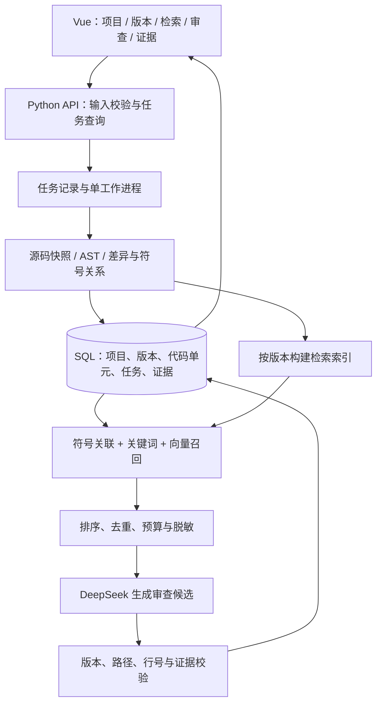

# 代码审查与知识库管理系统：SQL、Vue 与 RAG 改进及实施建议

编写日期：2026 年 9 月 20 日  
依据：你的《代码审查与知识库管理系统_开题报告.md》、当前 ReviewDesk 源码，以及本次查阅的官方文档与论文页面。  
性质：技术决策与开题修改建议。文中的新架构、工期和验收门槛均为建议，尚未实施或测得；本次没有改动应用代码，也没有调用收费模型 API。

**建议实施，但应分阶段改造。优先补齐结构化知识库和可验证的检索流程，再接 Vue；暂不把更换 MySQL、引入 FAISS 和增加复杂管理功能全部列为必做。**

你原稿第 5.1 节已经提出“Vue＋Python 后端＋MySQL＋FAISS”。目前需要改进的是技术选择的理由、相对现有软件的新增工作、交付方式，以及怎样证明增加的复杂度值得。

## 一、先明确：这个项目究竟要改成什么

### 1.1 建议的项目定位

建议将主线收敛为：**面向 Python 项目的、具有版本隔离和证据追溯能力的代码审查辅助系统。知识库服务于审查，同时提供代码查找功能。**

首版先回答三个问题：

1. 当前改动涉及哪些定义、调用约定和项目规范？
2. 在相同上下文预算下，混合检索能否比现有上下文选择方法提供更有用的证据？
3. 代码更新以后，审查结果能否仍然对应正确版本、文件和行号？

这三个问题可以形成数据库设计、检索方法和实验评估的完整论文章节。Vue 的作用是把项目、版本、证据和结果清楚地展示出来；数据库的作用是保存关系与状态。是否改善审查质量，需要由检索和模型实验回答。

### 1.2 与现有软件的关系

现有项目已经是可运行的 Python 桌面程序，不能把升级描述为从零开始。此次直接检查源码得到以下情况：

| 能力 | 目前的实际情况 | 改造时怎么处理 |
|---|---|---|
| SQL 数据库 | `storage.py` 已使用 SQLite，主要保存审查报告 JSON 和历史列表 | 扩展数据模型；不能写成“原系统没有数据库” |
| 代码解析 | 已有 Python AST 分析、静态规则、定义及部分调用/导入关系 | 复用解析逻辑，补代码块边界、版本身份和持久化 |
| 上下文选择 | 已有按文件截断和按风险/依赖优先的策略，记录实际发送行范围 | 保留为基线，新增可检索代码单元和融合策略 |
| DeepSeek 审查 | 已有调用、错误处理、用量记录、结果合并和本地证据检查 | 复用服务逻辑，扩展版本与证据字段 |
| 原始源码 | 分析时有内存快照；历史报告刻意不保存完整源码 | 知识库需要新增受控的源码快照存储与清理规则 |
| 前端 | PySide6 窗口与 Qt 工作线程 | Vue 页面需要新写；Qt 控件不能直接转换成 Vue 组件 |
| 知识库与 RAG | 没有持久化的代码块知识库、嵌入模型和向量检索 | 属于实质新增工作 |
| 变更审查 | 当前不是完整的“基线版本→目标版本”差异审查系统 | 补版本导入、差异定位、删除行和文件重命名处理 |
| 实验与交付 | 有既往测试、模拟盲评和 Windows 打包记录 | 保留原版作基线；旧测试不能证明新增 Web/RAG 功能可用 |

可核对的源码入口：[数据库与历史存储](D:/基于大模型的代码审查辅助工具设计与实现/后端功能/reviewdesk/storage.py:99)、[上下文构建](D:/基于大模型的代码审查辅助工具设计与实现/后端功能/reviewdesk/context.py:121)、[数据结构](D:/基于大模型的代码审查辅助工具设计与实现/后端功能/reviewdesk/models.py:92)、[结果校验](D:/基于大模型的代码审查辅助工具设计与实现/后端功能/reviewdesk/service.py:41)。

## 二、增加这三部分，各有什么好处和坏处

| 改造项 | 直接收益 | 主要代价或坏处 | 是否建议实施 |
|---|---|---|---|
| 结构化 SQL 知识库 | 能按项目、版本、符号、问题和证据查询；支持增量索引、历史追踪和实验复现 | 增加表关系、迁移、备份、删除和失败恢复；保存源码增加数据管理责任 | **建议优先做**，对项目功能和论文都有直接价值 |
| Vue 前端 | 更适合目录树、差异对比、检索列表、任务状态和证据联动；前后端职责清晰 | 需要重写页面，增加 HTTP 接口、前端状态、依赖构建和浏览器安全处理 | **建议第二阶段做**，前提是有足够时间并明确交付形式 |
| RAG | 可能补齐跨文件定义与规范，支持自然语言查找代码；可以开展明确的对照实验 | 会漏检、错检、引入过期上下文；增加嵌入开销、查询耗时和索引维护 | **建议做受控原型**，达到预设效果与成本要求后再扩大 |
| SQLite 换成 MySQL | 对共享服务、较多并发写入和独立数据库管理更合适 | 需要数据库服务、账户配置、升级和备份；普通电脑安装更复杂 | **有条件实施**，不是做 RAG 的前提 |
| 一开始就使用 FAISS | 提供成熟的向量搜索实现，可进一步研究索引性能 | 增加原生依赖和独立索引文件；还需自行管理项目/版本映射与一致性 | **先验证必要性和兼容性**，不把“用了 FAISS”当作效果证明 |

### 2.1 SQL：真正值得增加的是数据关系

SQLite 本身就是 SQL 关系数据库，也能表达主外键、索引和事务。它适合本地应用；当很多客户端需要共享数据库、同时写入时，服务型数据库更有优势。因此，“为了结合 SQL，必须换 MySQL”这个理由不成立。[SQLite 官方适用场景](https://www.sqlite.org/whentouse.html)

目前的报告 JSON 便于保存整份结果，但不适合反复回答“这个版本有哪些调用关系”“这个问题引用了哪份规范”“同一函数哪些版本已建立向量”等问题。结构化改造的收益主要来自能回答这些问题，而不是数据库名称发生变化。

MySQL InnoDB 提供事务、外键和并发控制，可以用于服务端方案。不过，换用 MySQL 不会自动提高代码审查准确率，也不会自动解决数据库与外部向量文件之间的一致性问题。[MySQL InnoDB 文档](https://dev.mysql.com/doc/refman/8.4/en/innodb-introduction.html)

### 2.2 Vue：收益主要在交互和工程组织

可以把复杂交互拆成项目选择、版本差异、问题列表、证据查看等组件，方便逐步维护。Vue 官方采用组件化的界面开发方式，适合这样的页面组织。[Vue 官方介绍](https://vuejs.org/guide/introduction.html)

但换前端本身不会降低误报率；原有源码高亮、关系图、选择文件、工作线程回调等交互需要重新连接。还会增加一层常见故障：页面正常但接口失败、任务已结束而页面状态未更新、前后端字段不一致。必须安排真实浏览器端到端测试，不能只测试后端接口。

### 2.3 RAG：收益取决于能否找到关键证据

例如某个函数改成“找不到用户时返回 `None`”，它的调用者仍直接访问返回值的字段。只看改动片段可能遗漏问题；检索到调用者后，模型才有机会判断影响。相反，如果只是局部语法或明显可变默认参数问题，现有静态检查往往更直接。

因此，需要区分两个目标：自然语言代码搜索追求“功能相关”，审查检索追求“判断该改动所必需的证据”。二者可以共享知识库，但不应完全共用查询构造和排序规则。

RAG 的基本思路是把外部检索内容引入生成过程，并不等同于必须使用某一个向量库，也不保证输出正确。[RAG 原始论文](https://arxiv.org/abs/2005.11401) 代码审查方面，LAURA 使用审查示例检索和上下文增强，说明这条路线值得研究；其论文结果不能直接当作本项目的预计提升幅度。[LAURA 论文](https://arxiv.org/abs/2512.01356)

RAG 的主要失败场景包括：检索到同名的错误版本；相似函数挤掉真实调用者；摘要编造接口约定；切分后缺少条件分支；把过去误报重新检索出来；无关代码消耗预算后反而挤掉当前改动。检索更多内容并不必然更好。

## 三、建议选择哪条实施路线

### 3.1 当前默认建议：保留单机交付，逐步引入 Vue 和 RAG

考虑到你此前要求“安装到另一台 Windows 电脑也能运行”，建议主线为：

**Vue 3 页面＋Python/FastAPI 接口＋SQLite 结构化知识库＋符号/关键词/向量混合检索＋现有 DeepSeek 服务。**

先完成检索和数据层验证，再接新页面。原 PySide6 版保留为可运行基线，迁移完成后再确定是否继续维护，避免长期同时维护两套完整界面。

这里建议交付的是“本地 Web 版”：安装后启动本机后端并打开浏览器。它可以保留双击启动的体验，但界面形态与目前原生窗口不同。若最终必须是独立桌面窗口，可后续加入 WebView；不建议首轮同时引入 Electron/Tauri、额外语言和另一套打包链。

Vue/Vite 可构建成静态资源，Python 后端可提供这些文件。由此推导，本地发布可以把页面产物和 Python 运行时一起打包，目标用户无需为了运行前端另外安装 Node.js；这是一条可行的设计路线，本次尚未做该新版本的安装验证。[Vite 构建文档](https://vite.dev/guide/build.html)、[FastAPI 静态文件文档](https://fastapi.tiangolo.com/tutorial/static-files/)

### 3.2 如果导师明确要求 MySQL 或多人共享

则在第一阶段就选定：**Vue＋FastAPI＋MySQL＋独立检索索引**，以 Web 系统部署作为主要验收形式。其他电脑通过浏览器访问已部署的后端，后端连接 MySQL；浏览器不直连数据库。

这时要在开题报告里说明：部署包包含前后端和数据库初始化说明，普通用户浏览器访问；“把单个客户端 EXE 复制到另一台电脑即可独立运行”不再是同一项交付承诺。若仍要求完全本地安装 MySQL，需要额外验证服务安装、启动、端口、账户、卸载和数据保留。

**这两条路线选一条作为首版验收对象。** 不建议为了展示技术栈，首版同时维护 SQLite/MySQL 双后端、原生窗口/浏览器双前端和本地/云端双部署。

### 3.3 数据与向量方案比较

| 组合 | 合适的场景 | 本项目的取舍 |
|---|---|---|
| SQLite＋关键词索引＋轻量向量检索 | 单机、中小规模、方便打包 | 默认起点；先把版本和检索做正确 |
| MySQL＋FAISS | 已确定 MySQL 的服务端毕业设计 | 可以采用，但要做两个存储之间的批次发布与恢复 |
| PostgreSQL＋pgvector | 数据库尚未定型，希望向量与元数据集中管理 | 可比较的替代方案；为避免再次换栈，不作为当前首选 |

FAISS 是向量搜索库，不负责整个系统的权限、任务、业务关系和数据库事务。[FAISS 官方说明](https://faiss.ai/) pgvector 能在 PostgreSQL 中管理和检索向量，但使用近似索引时仍需关注过滤后的召回数量；不能假定换成它就自动解决全部检索问题。[pgvector 官方过滤说明](https://github.com/pgvector/pgvector#filtering)

如果试点只有少量代码块，可先用精确向量相似度检索建立效果基线，再决定是否需要更复杂的索引。举例而言，10,000 个 768 维 float32 向量本体约占 29.3 MiB；这只是容量计算，不含模型权重、元数据和索引开销，也不是当前项目实测规模或速度。

## 四、推荐架构与现有代码怎么复用

关系数据库保存可追溯的数据，检索索引保存可以重建的加速结构，源码快照提供证据。三者职责应分别写清楚。

| 现有位置 | 复用内容 | 需要增加或调整 |
|---|---|---|
| `后端功能/reviewdesk/analysis.py` | 文件过滤、AST 分析、规则与静态关系 | 代码单元起止位置、父子关系、改名与差异关联 |
| `后端功能/reviewdesk/context.py` | 脱敏、预算、发送行范围 | 检索候选输入、版本化证据、融合排序；保留原策略作基线 |
| `后端功能/reviewdesk/service.py` | 任务服务、调用模型、校验与导出 | 与 HTTP 层分离的任务入口；版本、证据及检索日志 |
| `后端功能/reviewdesk/api.py` | 生成模型接口、错误和用量处理 | 嵌入接口另设边界，不把现有聊天调用当作向量生成 |
| `后端功能/reviewdesk/storage.py` | 历史报告和凭据保护原则 | 拆分数据访问职责、表迁移与任务状态；历史数据兼容 |
| `前端功能/reviewdesk_ui/` | 交互需求和使用流程可参考 | 新增 `前端功能/web/` 编写 Vue；旧 Qt 页面不强行改成 Web |
| `其它/tests/`、`其它/evaluation/` | 回归检查、匿名评分和记录规范 | 新建版本隔离、接口、浏览器及检索实验，不覆盖旧证据 |

新增模块建议放在现有三个分类目录内，不再改变根目录组织。第一阶段只扩展必要边界，不用一次引入通用 Agent 平台、复杂微服务和分布式队列。

HTTP 请求应尽快返回任务编号，前端轮询任务状态即可。任务必须有落盘状态，例如 `queued/running/succeeded/failed/interrupted`；重启后能识别中断任务，索引构建可以幂等恢复。收费生成请求超时则保留“结果未知/需人工重试”，不能为追求自动恢复而无条件重复扣费。FastAPI 的后台任务功能可以执行返回响应后的工作，但它不能替代本项目需要设计的持久化状态和恢复协议。[FastAPI 后台任务说明](https://fastapi.tiangolo.com/tutorial/background-tasks/)

## 五、数据库和 RAG 应该具体做到哪一步

### 5.1 数据库先实现核心关系，暂缓管理功能扩张

建议第一轮围绕以下实体设计。它们是逻辑对象，不要求第一天就一次建完所有表。

| 对象 | 最重要的内容 | 不能遗漏的约束 |
|---|---|---|
| Project / Revision | 项目、不可变版本、来源、导入状态 | 版本属于指定项目；不能把工作目录当前位置当永久版本 |
| SourceFile / CodeUnit | 路径、源码位置、哈希、所属符号、解析状态 | 文件路径在版本内唯一；哈希不能替代路径与版本身份 |
| SymbolRelation | 包含、导入、可确定调用关系 | 未解析关系保留状态，不编造动态调用 |
| KnowledgeItem | 规范或人工确认案例、适用范围、来源 | 案例有审核状态和时间；测试答案不能入库 |
| IndexBatch / EmbeddingMap | 索引状态、嵌入模型、维度、内容映射 | 一个已发布批次的维度、模型和预处理规则固定 |
| ReviewTask | 基线/目标版本、配置、状态、费用 | 任务锁定实际使用的版本和索引批次 |
| Finding / Evidence | 问题、反馈、引用对象、行号、证据用途 | 问题位置与多个支持证据分开记录，可追溯到当时快照 |

代码快照可采用应用数据目录中的内容寻址文件，数据库保存相对位置和哈希。原始源码可能含敏感内容，不应默认跟随报告导出；需要明确保留期限、用户删除和备份范围。向量也不应被当作已经匿名化的数据。旧报告没有源码快照，导入新系统时应标记“历史报告、证据快照不可恢复”，不能反推出并补造当时的上下文。

现有界面的“采纳/忽略”是用户处理状态，不等于“确认真实缺陷/确认误报”。案例库应另设人工核实状态、复核说明和适用版本；不能直接把旧反馈全部作为检索真值。

特别需要修正原稿中的证据模型：旧版本和新版本可能都有 `utils.py:42`，但内容不同。建议证据至少携带：

`project_id + revision_id + relative_path + start_line/end_line + content_hash + source_type`

对于问题位置，再加 `side=base/target` 或明确的差异标识。删除行属于基线版本，新增行属于目标版本；项目规范和历史案例是辅助依据，不能冒充当前源码中的事实。

### 5.2 RAG 先走这条最短有效流程

1. 固定项目和目标版本，提取当前差异及涉及的符号；需要旧行为时单独加入基线片段。
2. 优先找被调用定义、导入对象和直接相关调用者，保留“关系未解析”的情况。
3. 关键词通道对标识符、路径和文档字符串检索；处理 `snake_case`、`camelCase` 等命名方式。
4. 向量通道补充用词不同但相关的代码和规范；两条通道都在允许的项目、版本和资料范围内检索。
5. 融合排序、合并重复片段，在预算内保留当前变更和关键定义，记录被排除的资料。
6. 模型依据实际证据生成候选；后端继续检查位置和摘录，人工判断逻辑是否成立。

SQLite 路线可先检查运行环境是否启用 FTS5，再利用其全文检索和 BM25 排序；代码标识符与中文查询仍需另做分词验证，不能认为通用全文搜索会自动理解代码。[SQLite FTS5 文档](https://www.sqlite.org/fts5.html#the_bm25_function)

先用源码、签名、路径和人工规范建立索引，不要把“为每个函数调用模型生成摘要”设成导入成功的前提。摘要可后加、可缓存、可人工修订；其内容只能辅助检索，源码仍是判断接口行为的依据。

### 5.3 索引更新：可以暂时不可用，不能悄悄用错版本

建议采用“新批次构建→映射核验→数据库事务发布”的方式，原稿这个方向可以保留。需要补充一个规则：**新版本索引失败时，旧版本仍可查询，但不能用旧索引冒充新版本来执行审查。**

每个任务记录固定的索引批次；更新过程中不改变正在执行任务看到的资料。删除代码后，需要同步从新批次召回集合中排除，不能仅在数据库中删除一行。向量缓存键除内容哈希外，还要覆盖实际参与嵌入的路径/签名等内容、模型版本、切分与预处理版本；同一源码以不同输入模板生成的向量不能随意复用。

### 5.4 首轮暂缓的功能

重复代码判定、批量自动摘要、复杂标签体系、跨项目案例共享、多人权限、完整 Git 托管接入和自动修复均先暂缓。保留人工确认反馈，但反馈进入案例库必须有单独审核。否则项目会同时承担代码审查、代码搜索、重复检测和知识运营四条产品线，实验与维护量会迅速增加。

## 六、最值得提前处理的风险

| 风险 | 对当前项目的实际影响 | 建议的控制方法 |
|---|---|---|
| Python/原生依赖兼容 | 现有环境是 Python 3.14；新嵌入运行时、向量库和打包链不一定能直接组合使用 | 第一周验证安装、导入、向量生成和打包；选定一套版本后锁定，不直接替换现有环境 |
| 两套界面并行维护 | 容易一边修 Qt、一边修 Vue，功能逐渐不一致 | 旧版固定作基线；新增功能集中到选定主线 |
| 本地 Web 的访问边界 | 本机端口和文件接口增加访问入口 | 仅绑定回环地址，校验来源与会话，拒绝任意路径读取；密钥留在后端 |
| 模型与文档内容不可信 | README、源码注释或模型 HTML 可能成为指令注入/页面注入来源 | 资料只作数据，严格校验证据；前端安全渲染，不直接执行输出或插入不可信 HTML |
| 上传项目 | 压缩包越界、膨胀、大量小文件和链接对象可能绕过限制 | 限制解压后总大小与数量、核对真实目标路径、不执行上传代码 |
| 索引与数据库错位 | 看似返回了正确代码，实际对应旧版本或错误单元 | 不可变批次、发布校验、任务固定批次和故障注入测试 |
| RAG 负收益 | 上下文更长、成本更高，但漏检没有下降 | 保留非向量基线；在开发集上确定是否保留向量通道 |
| 评测失真 | 测试答案进入案例库，或看了结果再修改评分规则 | 预先划分与冻结、隐藏答案、匿名评分、如实报告失败 |
| 交付退化 | 新方案只在开发电脑能跑，安装包失去价值 | 第一周就验证目标部署方式，最后在无开发环境的干净 Windows 环境验收 |

FAISS 官方提供 Windows x86-64 CPU 版支持，因此不能直接说“Windows 用不了 FAISS”；但这不等于本项目的 Python 3.14、选定嵌入模型和 PyInstaller 组合已经验证。[FAISS 安装说明](https://github.com/facebookresearch/faiss/blob/main/INSTALL.md)

如果采用云端嵌入，索引构建本身就会向服务方发送代码；即使还没点“DeepSeek 审查”，也可能已经发生外发和费用。若采用本地嵌入，则增加模型下载、磁盘、内存及启动开销。这是嵌入模型选择时必须说明的取舍。

## 七、怎样证明改造值得，而不是只增加技术名词

### 7.1 改进原稿的实验对照

原稿 A/B/C/D 四组有价值，但“混合检索优于向量检索”不足以说明向量本身值得加入。原稿另提了去掉符号关联或仅用关键词的消融；建议在此之外，**新增并优先开展“符号＋关键词、无向量”组**。

| 组别 | 输入/方法 | 回答的问题 |
|---|---|---|
| A | 仅差异与必要文件标识 | 最低输入成本的效果如何 |
| B | 差异＋固定邻域 | 简单增加上下文能改善多少 |
| C | 差异＋向量检索 | 纯语义召回的收益与误检 |
| D | 差异＋符号关联＋关键词＋向量 | 完整方法的综合表现 |
| E | 差异＋符号关联＋关键词，无向量 | 向量相对较便宜方法是否有额外价值 |

资源不足时，先做 A/C/D/E，B 放到补充实验。现有 `dependency` 策略也应保留作工程基线；它并不等于新增的 E 组，不能换一个名称就算实现了关键词检索。

为了避免变量混杂，研究检索效果时，各组使用同一生成模型、提示要求和输出上限，B—E 使用相同的外部上下文预算上限，A 保留只输入差异的低成本条件；记录实际 token，而非声称每组实际输入完全相等。静态检查结果可以在所有组中采用相同规则合并，同时分别报告“模型候选结果”和“合并后的产品结果”。

### 7.2 先做小样本决策，再做论文实验

第一轮建议使用独立开发样本，例如 20 个变更加 20 条检索查询，检查流程能否跑通、跨文件证据是否被找回，以及每次调用的实际开销。这个规模是试点建议，不足以形成通用准确率结论。

正式实验可沿用原稿约 40 个开发样本、80 个测试样本的计划，前提是标注工作量可承担。最终测试前冻结切分方法、模型、检索参数和评分规则；按项目或缺陷家族隔离样本，避免相同问题换个文件名就进入另一个集合。检索允许使用当前目标版本的代码，但不得纳入未来修复、最终测试答案或测试输出反馈。

AACR-Bench 的论文页面讨论了仓库上下文和标注完整性对评测的影响，可作为选样和评测设计参考；本次没有下载或审核其数据许可、Python 子集及可恢复性，因此不把它列为已确定采用的数据集。[AACR-Bench 论文](https://arxiv.org/abs/2601.19494)

### 7.3 评分与盲测安排

- 系统运行方只能读代码和允许的知识资料，不能读缺陷答案；采集前冻结候选实现及配置哈希。
- 评分方看到打乱的输出编号，隐藏方法名称、检索策略及来源，按同一标准判断缺陷和证据。
- 评分规则和争议处理流程先确定，完成评分后再揭示方法对应关系。
- 条件允许时，请独立同学复核一部分样本和全部争议项；若只有单人或多个 AI 角色参与，应称“匿名盲评/模拟盲评”，不能写成已经完成严格的人类双盲实验。

不同方法可能留下格式或内容特征，因此要尽量统一输出结构，并在论文中说明盲法可能不完全。现有冻结的合成样本及其评分可作历史基线，不能被改造成新 RAG 系统已经得到的分数。

### 7.4 保留哪些指标

审查主指标使用查准率、召回率、F1，以及无缺陷样本误报率；分别报告单文件与跨文件样本。检索使用 Hit@5、MRR@10，并增加“审查必需证据是否召回”的标注，避免只检到语义相似代码却缺少关键接口约定。

证据指标分成自动位置合法率和人工语义支持率。工程指标记录索引时间、检索延迟、端到端耗时、API 失败率、token、实际返回用量对应的估算费用。重复运行的波动单独展示；条件允许时给出成对比较或 bootstrap 区间，不能只挑一次最高分。

是否把向量通道设为默认，需要在正式测试前用开发集确定决策规则。可采用这样的预设门槛示例：相对 E 组，跨文件召回提高且查准率下降不超过 2 个百分点，单次费用不超过 E 组的 1.5 倍；或质量相近但在另一项预先指定指标上有明显收益。**这些数值只是可讨论的产品门槛，不是文献标准、实测结果或统计显著性结论。** 样本较少时，应同时检查置信区间和具体错误，不能机械按一个百分点决定成败。

如果 D 不优于 E，保留结构化知识库和符号/关键词检索，把向量通道降为可选即可。这仍然是有价值的实验结果。

## 八、时间和费用是否可承受

### 8.1 以原稿 16 周为前提的安排

以下按一人实施、能够持续投入、复用现有后端估算，是安排建议，不是已经确认的交付日期。

| 周次 | 主要任务 | 阶段通过条件 |
|---|---|---|
| 1—2 | 明确单机/服务端路线；验证依赖；做检索小样本和基础部署原型 | 能导入、检索、带证据审查；选定一种数据库和部署方式 |
| 3—4 | 项目/版本/代码块入库，源码快照、索引批次、符号＋关键词基线 | 同名文件跨版本不混淆，删除和重建结果可核对 |
| 5—6 | Python API、Vue 项目页/检索页/任务页 | 页面完成实际流程，失败状态和刷新行为正确 |
| 7—8 | 差异审查、向量通道、证据联动和预算控制 | 同一任务可回看引用版本，删除行和改名有明确处理 |
| 9—10 | 索引更新、重启恢复、数据清理和目标环境交付验证 | 故障不会发布半成品索引，干净环境可启动 |
| 11—13 | 冻结样本、正式对照、盲评及结果分析 | 原始结果、成本和失败记录可复查 |
| 14—16 | 论文、使用说明、导师反馈与答辩演示 | 完整交付并能解释自己的方法与局限 |

如果实际只剩四周左右，建议保留 PySide6，优先扩展 SQLite 和做检索试点；此时全面重写 Vue、引入 MySQL、重做安装器的风险较高。若有八周左右，压缩为少量核心页面和有限样本，暂缓案例运营、重复检测和多用户功能。

### 8.2 费用需要重新估算

原稿安排 80 个最终测试样本、4 组、每组 3 次运行，已经是 **960 次生成调用**；若 A—E 五组都做，是 **1,200 次**。这还没有计入开发试验、嵌入、摘要和必要的重跑。之前用于验证 API 的少量余额，不能据此视为足够覆盖整个研究。

预算公式建议写为：

`总预算 = 各组实测平均单次生成费用 × 样本数 × 重复次数之和 + 嵌入费用 + 可选摘要费用 + 预留重跑费用`

先用开发样本测实际用量，再在实验前核查对应模型的价格。不要把“多了 RAG”直接写成“更省 token”：相比全仓库输入可能更省，相比只发差异也可能更贵。本报告不假设余额仍与之前相同，也没有读取余额或消耗额度。

## 九、你的开题报告具体应该怎样改

| 原稿位置 | 建议修改 | 原因 |
|---|---|---|
| 题目、3.1 总体目标 | 确定“审查主线、知识库支撑”，并写清本地 Web 或集中部署 | 避免目标同时包含桌面工具、团队平台和通用代码管理系统 |
| 3.2、4.2 | 将重复候选、批量摘要和复杂标签降为扩展 | 把标注和实现时间留给核心审查实验 |
| 5.1 技术选择 | 补充 SQLite 已存在的事实，以及选 MySQL/保留 SQLite 的条件 | 技术选型要对应问题，不以换栈作为进步证据 |
| 5.2、5.4 | 增加不可变源码快照、证据版本和 `base/target` 位置 | 历史报告和差异审查需要可恢复的依据 |
| 5.5 一致性 | 增加任务锁定批次、失败版本不可检索和重启恢复 | “保留旧版本”不能变成“旧内容冒充新版本” |
| 6.2 对照实验 | 新增并优先开展无向量混合组，保留现有方法基线 | 能回答向量检索的额外成本是否值得 |
| 6.1、6.3 | 单独标注必需证据；新增失败率、费用和版本隔离指标 | 不把代码搜索效果等同于审查质量 |
| 7、8 | 第一阶段加入依赖/部署验证；按实际调用次数预算 | 避免末期才发现打不成包或实验额度不足 |
| 参考文献 [5] | 补核正式会议出处 | 当前 LAURA 页面已列出 ASE 2025、2983–2995 页及 DOI，不能笼统把它只当作未发表预印本 |

LAURA 的会议信息可在其作者稿页面核对，正式引用格式仍需遵循学院要求。本次核查了该条的页面信息，不代表已经完成全部参考文献的格式和全文审查。[LAURA 来源与会议记录](https://arxiv.org/abs/2512.01356)

### 可直接用于修改“总体目标”的文字

> 本课题拟在已有 Python 代码审查原型基础上，设计具有版本隔离和证据追溯能力的代码审查辅助系统。系统通过关系数据库组织项目、源码快照、代码单元、依赖关系与审查结果，采用符号关联、关键词和向量检索选择上下文，并通过 Vue 界面展示版本差异、检索来源和问题证据。研究重点是在固定模型与上下文预算下，分析不同检索策略对跨文件问题检出、误报和调用开销的影响。首版限定 Python 项目，保留人工确认，不自动执行或修改被审查代码。

### 可直接用于修改“技术路线”的文字

> 系统采用 Vue 与 Python 后端分离的结构，复用已有 AST 分析、模型调用及结果校验模块，新增项目版本管理、代码单元索引与证据存储。以单机部署为首版目标时，使用 SQLite 保存结构化数据，由本地 Python 服务提供 API 和已构建的前端资源；若开题确认以多人共享及 MySQL 为要求，则统一采用服务端部署与 MySQL，并按该方案开展数据库集成和部署测试。检索模块先建立符号与关键词基线，再评估向量通道的增益。索引按版本与批次发布，审查任务固定引用批次，确保结果能够追溯至当时实际使用的源码与资料。

正式提交前应从上面两种部署表述中选定一种，并删除另一种条件分支，不能把尚未选择的方案同时写成已经确定的技术路线。

## 十、实施决定

**建议改。应保留现有分析和校验能力，把开发重点放在“有版本的知识库＋有依据的检索＋可复现的评价”。**

结构化 SQL 改造直接支持新功能，值得优先实施。RAG 值得用实验验证，但不承诺一定优于现有方法。Vue 适合新增的项目、版本和证据管理页面，放在后端接口稳定后实施。MySQL、FAISS 是否采用，应分别由部署需求、数据规模、兼容性和实测效果决定。

在当前条件下，最先值得投入的一步是：**利用现有后端做一个包含项目版本、代码单元、符号/关键词基线和向量对照的小型原型，先证明流程与研究问题成立，再投入完整界面改造。**

本报告中的代码现状已按当前文件核对；依赖兼容性、新部署方式、RAG 性能和新增费用尚未实测。源码检查与文献页面核查不能替代后续实现验收。
